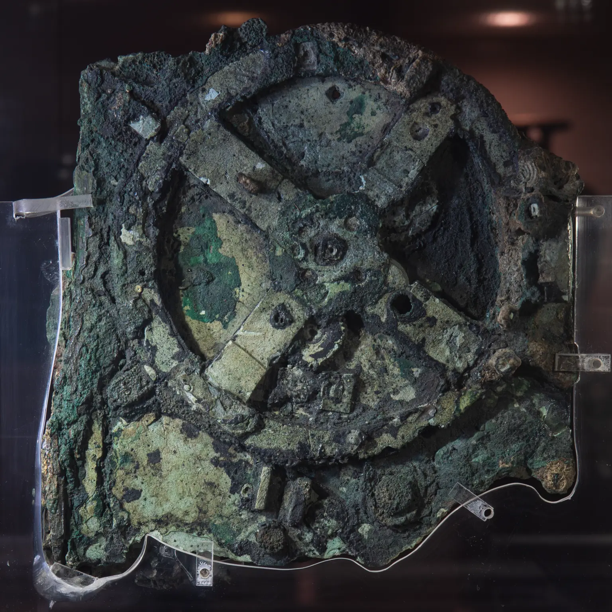
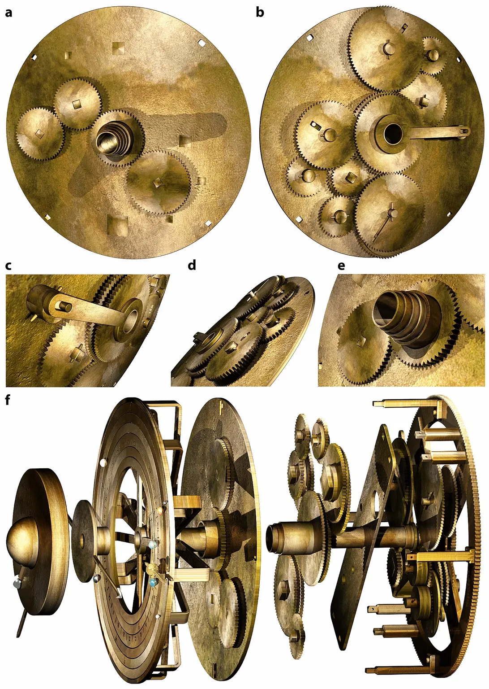

## 海底的一團青銅

一群希臘潛水夫，一次又一次潛到安提基特拉島外的海底。他們本來是來採海綿的，卻在海床上碰到一艘古船的殘骸，船上載著青銅雕像和各式各樣的貨物。1900 到 1901 年，在希臘皇家海軍的協助下，他們把船貨一趟一趟撈上岸。

這艘船大約在公元前 60 到 50 年沉沒，船上的貨物卻橫跨公元前 4 世紀到公元前 1 世紀。最引人注目的是那批青銅雕像，例如只剩下頭、雙腳和一部分外袍的「安提基特拉哲學家」。1976 年，希臘考古單位和庫斯托的海洋調查船「卡呂普索號」又回到這裡做了第二次調查。

在這些雕像旁邊，有一團毫不起眼的青銅，綠綠的、硬硬的，像長滿鏽的石頭。它和其他船貨一起被送進雅典的國家考古博物館，起初沒有人注意它。學者推測，它撈上來的時候可能還是完整的一塊。幾個月後，這團青銅裂開了，裂縫裡露出一個個精密的齒輪。這在當時引起不小的騷動，但沒有人真正明白它是什麼。

一艘兩千多年前的船上，為什麼會有齒輪？它們又在算什麼？

## 只剩三分之一的拼圖

今天的安提基特拉機械不是一台完整的機器，而是 82 塊碎片：7 塊較大的編為 A 到 G，另有 75 塊小碎片。它們也不是一次找齊的：E 片是 1976 年才在博物館裡被找到的，F 片和一大批小碎片，則是 2005 年從博物館青銅收藏的庫房裡找出來的。

這些碎片加起來，大約只有原本機器的三分之一。裡面殘存 30 個鏽蝕的青銅齒輪，其中 27 個擠在最大的 A 片裡，B、C、D 片各只有 1 個；齒輪上的每顆齒，只有大約 1.5 公釐長。這台機器原本裝在木盒裡，前後各有一片刻著文字的青銅板。

要看清楚一團鏽在一起的青銅，光用眼睛不夠。2005 年，博物館的館員與保存修復人員，和惠普公司的影像團隊、X-Tek 公司的 X 光專家合作，替碎片做了表面成像與高解析度的 X 光斷層掃描。就像醫院用電腦斷層看身體裡面，研究者因此能一層一層看進碎片內部：哪個齒輪咬著哪個齒輪、軸心在哪裡，還有數千個藏在碎片裡、兩千多年來沒有人讀過的細小希臘文字。

## 背面：月曆、運動會與日月食

背面是拼得最清楚的一面。上方是一條繞五圈、分成 235 格的螺旋，一格一個月；235 個月接近 19 年，過了 19 年，月相和季節大致又會對齊。十二個月只有大約 354 天，比一年少了十一天左右，所以古希臘的月曆每隔幾年就要多插一個月，19 年的週期正好用來安排這些多出來的月。十二個月的月名已經全部讀出，屬於科林斯和它的殖民城市那一系的曆法。螺旋裡還有一個分成四格的小刻度盤，刻著伊斯特米亞、尼米亞、奧林匹亞、皮提亞等泛希臘運動會的名字，四年一輪，古希臘人也習慣用這樣的奧林匹亞週期來紀年；這個小盤以前被當成 76 年的天文週期，2008 年才被重新解讀為運動會的時間表。背面下方是另一條繞四圈、分成 223 格的螺旋，223 個月是古人預測日月食用的週期；有些格子裡刻著小符號，標出那個月可能有日食或月食，還附上時刻。學者推測，這些符號是照巴比倫式的預測方法排出來的，而不是抄錄過去的觀測紀錄。轉動機器，背面的指針就一格一格前進，指出現在是哪個月、今年輪到哪一場運動會，以及哪些月份要留意日月食。

## 正面：月相是兩種轉動的差

正面保存得差得多，但月亮的部分有實物可依。正面外圈有黃道十二宮和埃及曆的刻度，中央有月亮的指針，由中心的轉軸帶著，指出月亮在黃道上的位置；旁邊是一顆一半黑、一半白的小球：月亮指針和太陽指針重疊時，小球轉到黑色那一面，代表新月；兩根指針指向相反方向時，小球轉到白色那一面，代表滿月。

月亮大約一個月在星空中繞一圈，太陽則要一年。我們看到的月相，取決於月亮和太陽在天上相差多少角度：兩者重疊是新月，相差半圈是滿月。所以，把月亮的轉動減去太陽的轉動，剩下的差就是月相。機器裡的月相裝置做的正是這件事：一組齒輪把兩種轉動相減，再用相減的結果帶動那顆黑白小球。

月亮還有一個麻煩：它在星空中走得時快時慢，不是等速前進。機器背後有一組大致保存下來的齒輪，專門算出月亮這種忽快忽慢的位置，再送到正面的月亮指針。製作者不只知道月亮會變圓變彎，也知道它的速度會變，而且用齒輪把這件事做了出來。

## 它到底有多老？

博物館把這台機器的年代定在公元前 2 世紀下半葉。這個年代主要來自銘文的字體：不同時代刻字母的寫法不同，學者推測它大約做於這段時間，但稍早或稍晚都有可能。沉船大約在公元前 60 到 50 年，所以它上船的時候，可能已經做好幾十年了。

另一個常被提到的數字是公元前 205 年，它來自背面的日月食刻度盤。Freeth 在 2014 年用數學模型比對刻度盤上的符號與時刻，最吻合的起點是公元前 205 年 5 月的一次滿月；他也提醒，模型並不完全精確，這個結果要謹慎看待。

日月食盤的起算年代，也不等於機器的製造年代。一本萬年曆可以從很多年前的某一天排起，印出來的那一年卻晚得多。Freeth 明白寫道，不能直接推論機器就是在刻度盤設計的那一年做的，它可能是後來才做的。所以「公元前 205 年」可能是刻度盤開始算的那一天，而不是機器做好的那一天。

## 流行說法對照證據

第一種說法和外星人有關。科普節目 Skeptoid 第 184 集整理過：有一種說法認為，這台機器比同類機械早了將近一千年，所以它是時間旅行、外星人造訪，甚至亞特蘭提斯存在的證據。把證據攤開來看，機器上的東西都對得上它的時代：銘文是希臘文，月名屬於科林斯一系的曆法，223 個月的日月食週期是巴比倫天文學家早就在用的，運動會刻度盤記的是希臘人自己的節慶。學者推測，它的設計可能結合了巴比倫的天文週期、柏拉圖學園的數學和古希臘的天文理論。這些線索都指向它自己的時代。

第二種說法是「它是世界上第一台電腦」。先說「第一台」：博物館稱它是現存最早的可攜式天文計算器。這個稱呼限定了我們在比較哪種器物，不能省掉「現存」與「天文計算器」，直接變成所有計算工具的第一台。再說「電腦」：研究者自己也用這個詞，2021 年的論文開頭就稱它是「用青銅齒輪做成的機械電腦」。它確實在計算：轉動輸入的轉軸，齒輪就照齒數的比例算出月亮、太陽的位置與可能發生日月食的月份。不過從現有的重建看，它的每一項功能可能都由齒數固定下來，不像今天的電腦可以換一個程式去算別的事。稱它是「用齒輪把天文週期做成刻度的計算機器」，可能比「電腦」更貼切。

第三種說法是「它是阿基米德做的」，線索來自古書記載。羅馬作家西塞羅在《論共和國》裡寫到，羅馬將軍馬塞盧斯攻下西西里的敘拉古後，把阿基米德做的一個天球儀帶回家；從那座富裕城市的大批戰利品裡，他只帶了這一件。書中說，實心、不會轉的天球早就有人做過，阿基米德了不起的地方，是讓這個裝置轉一次，就能同時重現太陽、月亮和五顆行星快慢不一的運行，月亮落後太陽的圈數和天上的日數相合，還能演示日食，以及月亮落進地球影子裡的月食。在《論神性》裡，書中人物也提到他們的朋友波希多尼新做了一個天球儀，每轉一圈，太陽、月亮與五顆行星的運動都和天上一日一夜相同。

古書記載說明，古代地中海世界確實有人做過這類會轉的天文裝置，但不能說明沉船裡的這一台就是阿基米德的作品。在年代上，學者意見不同。阿基米德在公元前 212 年敘拉古被攻陷時身亡，而公元前 205 年的起算點只比他的死晚 7 年；Freeth 在 2014 年推測，這個起算點讓機器的年代靠近阿基米德的時代，他對日月食銘文的新分析也和公元前 205 年相符，但字體的比較仍有爭論。即使如此，Freeth 也寫道，說它是阿基米德和數學家阿波羅尼奧斯合作設計的，純屬臆測；它也可能出自一位歷史沒有留下名字的天才。另有學者推測，它可能屬於敘拉古一個從阿基米德開始的製作傳統，這一點同樣還沒有直接證據。

## 正面的宇宙，多半是重建的

後蓋上的銘文像一份使用說明，描述正面有一個「宇宙」顯示：行星用「小球」標示，太陽是一顆附有「光芒」和「指針」的「小金球」。前蓋的銘文列出各顆行星的週期，殘存的文字裡讀得出金星的 462 與土星的 442 兩個數字。所以正面可能還顯示著古代已知的五顆行星。

但負責太陽與行星的齒輪幾乎全部遺失了。2021 年，倫敦大學學院的 Freeth 團隊依照銘文裡的週期，以及 A 片與 D 片上殘留的支柱、孔洞和零件痕跡，提出一套可能裝得進這麼小空間的齒輪模型。論文作者寫明，太陽和行星的實物證據已經不見了，模型裡的是他們推出來的理論機構；用來指出月交點的「龍頭指針」，更是沒有直接實物證據、刻意加進去的假設。

仍有爭論的是：它到底轉不轉得動？2025 年，一份尚未經同儕審查的研究用電腦模擬檢驗齒輪的製造誤差。兩位學者推測，如果照目前一份對齒輪誤差的估計，齒輪很容易卡住或脫齒；那麼要嘛這台機器從來沒有順利運轉過，要嘛它實際的誤差比那份估計小。他們推測後者的可能性較高，也提醒結果要謹慎解讀。

## 還不知道的事

誰做了這台機器，又是在哪裡做的，至今還沒有答案。背面月曆用的是科林斯一系的月名，學者據此推測，它是設定給三個地區之一的人使用的：科林斯一帶，以及科林斯在希臘西北部和西西里的殖民地；有學者推測敘拉古最可能，但也強調遠遠不能確定。卡住的地方在於：月曆只能告訴我們機器是設定給哪裡的人用的，不能證明它就是在那裡做的；而目前讀出的銘文與碎片，還不足以把範圍再縮小。

它和古書裡那些天球儀的關係，也還不知道。古書記載過阿基米德和波希多尼的天球儀，但它們和沉船裡的機器之間，缺的是能接起來的證據：古書只描述裝置能做什麼，沒有留下零件的細節可以和碎片比對，所以還不知道它是當時一整個製作傳統中的一員，還是罕見的孤品。

仍有爭論的是正面的行星齒輪長什麼樣、月交點指針是否存在。答案卡在遺失的零件上：除非在沉船遺址或博物館庫房裡找到更多碎片，否則正面的模型只能停在「最符合現有證據的重建」。
