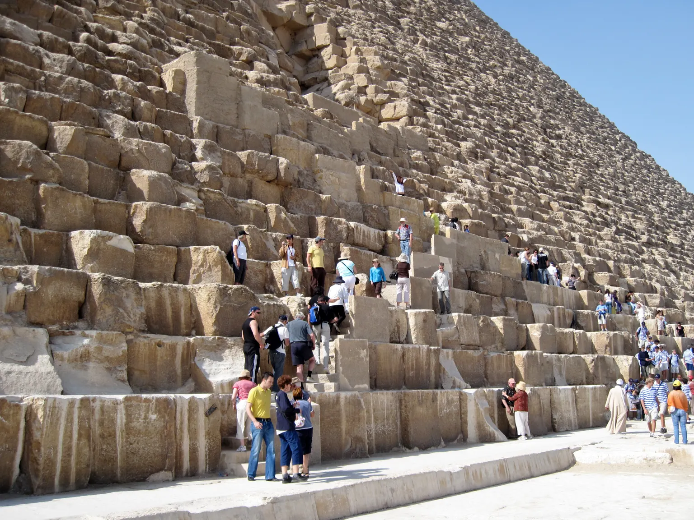

## 一份每天都在運石頭的日誌

第二十七天，梅勒的船載著石頭，朝胡夫金字塔的工地前進，在那裡過夜。第二十八天早晨，船又離開，往上游的圖拉南部回航。接下來兩天，紀錄裡的工作都是搬運石頭。沒有奇蹟，也沒有秘密機器，紙莎草上留下的是一趟接一趟的工作。

這幾行出自「梅勒日誌」。二〇一三年，考古團隊在紅海岸邊的瓦迪傑爾夫港口發現這批紙莎草。發現地在紅海，文字記下的這段行程卻在尼羅河：從圖拉的採石區，把石灰岩送往吉薩。刊布日誌的考古學者皮耶・塔萊在二〇一七年的英文附錄中，依照紀年換算，推測這段紀錄屬於胡夫在位第二十六年；日誌不是用我們今天的西元年份標日期。

梅勒是一名帶領工作隊的官員。日誌按日記下工作、航行與過夜地點；有些地方破損了，譯文保留缺字，沒有把每一段行程補成完整故事。紙莎草 B 的另一段還記著有人搭船去領食物，也記著把石頭裝上運輸船。建造金字塔的線索，藏在這些平凡而重複的事項裡。

這份紀錄能回答「石頭怎麼運到工地」的一部分，卻沒有回答「怎麼抬到塔頂」。塔萊明白指出，日誌不記載金字塔的施工技術。學者推測，這些來自圖拉的細質石灰岩可能主要用於外層包覆，但不是每一塊都能確定用途。把運貨紀錄當成整座金字塔的施工說明書，就超出了文字留下的範圍。

## 石塊旁邊的人

先看一張今天的照片。胡夫金字塔北面，遊客站在石塊旁，有人坐在低處。石頭沒有整齊得像工廠切出的積木：有些高、有些低，邊角與表面都不一樣。人的身體讓我們有了比較大小的參照，但照片沒有秤重，也沒有拍到四千多年前的搬運現場。

面對這樣大的石塊，很容易先問一個人搬不搬得動。但金字塔不是一個人的工作；問題也不只在手臂能出多少力。採石、裝船、接貨、準備工具與供應食物，要能接得起來，前一道工作完成，下一道才有材料可用。梅勒日誌讓我們看見其中一個運輸環節，遺址則把鏡頭拉到船隊以外。

在獅身人面像以南約四百公尺，古埃及研究協會 AERA 自一九八八年起發掘 Heit el-Ghurab 聚落。這個地方的阿拉伯語名字和附近的「烏鴉之牆」有關，常被稱作金字塔工人城。發掘範圍揭露了麵包坊、廚房、倉庫、作坊與住宅，行政建築區還有十座大型穀倉。巨石留下來了，供應建造者生活的設施也留下了痕跡。

AERA 的學者推測，這座聚落是卡夫拉、門卡烏拉金字塔工程的基地，至於是否也服務胡夫工程，機構的說明保留了「可能」。這個差別不能省略：我們不能把聚落裡每一座房子都指定給梅勒居住，也不能把不同國王時期的工人當成同一批人。

學者推測，這些設施反映了有組織、能集中物資的工程體系。有人搬石頭，也有人處理糧食、修整工具、分配物資。AERA 的學者推測，聚落後來的拆除可能與門卡烏拉工程完成有關。牆壁、穀倉和工具提供線索，關於它們如何一起運作，仍要經過解釋。

## 河流曾經靠得更近

日誌裡有船，但今天看金字塔照片，最醒目的往往是沙地。若只用現代景觀想像古代，石頭就像必須一路穿越乾燥陸地。河道會移動，水位會變，昔日的岸邊未必還在今天的岸邊。要找回梅勒工作時的環境，得看地底的沉積物。

二〇二二年，Sheisha 與同事發表胡夫支流研究。他們在吉薩氾濫平原鑽取岩心，分析其中的花粉。靠水生長的植物和較乾燥地面的植物，留下的花粉組合不同；團隊把這些變化與定年資料放在一起，重建古代水域的起伏。這不是在沙子下找到一把古代水尺，而是用植物遺留的訊號，推估河流環境。

學者推測，古王國前半期，約公元前二六八六至二四四〇年，重建的胡夫支流水位相對穩定，約為非洲濕潤期水準的百分之四十。這個數字指向研究的相對水位重建，不能直接換成「河水有幾公尺深」，也不是「只剩百分之四十的水量」。年代與曲線都有不確定範圍，不能用它來計算梅勒某一天的船底離河床多遠。

學者推測，這樣的水路環境有利於規劃船運，把石料與物資送到金字塔工程區。日誌提供人的活動，花粉提供環境變化，兩者能互相對照，卻各有邊界：花粉不會寫出船長姓名，日誌也不會量出整條河的水位。

二〇二四年，Ghoneim 團隊另提出 Ahramat 古支流研究，把視野擴大到吉薩以南的一串金字塔。學者推測，已消失的支流可能有助於解釋這些工程為何沿著那條帶狀區域分布。這項研究結合衛星影像、地形資料、地球物理調查與土壤鑽探，在三十一座金字塔所分布的區域辨認古河道片段。鑽探帶來沉積物的線索，地表與地下的資料互相對照，才有可能把已經消失的水路畫回地圖上。不過，河道圖上約六十四公里的範圍，並不是每一公尺都挖開驗過；研究使用的兩支鑽芯，也不能替每一座金字塔各自說明船隻怎麼進出。

這項區域性的解釋，和梅勒的運輸紀錄關心的尺度不同；它不是每座金字塔各自的運貨清單，也不能直接把新畫出的河道當成某一趟船的確切航線。

## 流行說法對照證據

有一種說法認為，金字塔是外星人蓋的。二〇二〇年七月，馬斯克在社群貼文中也說了這件事；Egyptian Streets 的報導保留了貼文與埃及方面的回應。這裡引用它，是交代現代說法的出處，不是把名人的一句話當成考古證據。

外星人的說法常從「這麼大的石頭，人怎麼搬得動」開始。但我們手上並不是什麼都沒有：有具名的運輸官員、按日記錄的石料航行，有工地附近的生活與儲糧設施，也有古代水路的研究。這些材料讓我們可以具體討論人怎麼分工。就算抬升方法還有爭論，也不能把這一段空白直接填成外星人來過。

另一種常見畫面，是把全部建造者想成被鞭打的奴隸。Jonathan Shaw 在二〇〇三年《Harvard Magazine》的〈Who Built the Pyramids?〉中，把這種大眾印象的流傳連到《十誡》等好萊塢作品。這說明影像如何讓一種說法變得熟悉，不代表電影演的就是吉薩工地。前述二〇二〇年的報導引述考古學者哈瓦斯反對「奴隸建塔」的說法，也引述雷納對義務勞動的提醒：古代人的選擇與今天不同。這裡需要把兩件事分開，聚落有飲食供應，不等於每個人都能自由選擇是否參與；有勞動義務，也不等於每個人都有同一種法律身分。

目前列出的日誌與聚落資料，支持我們討論一個有分工、有物資供應的工程體系。至於每個人的身分、徵調方式與生活條件，不能只憑一座穀倉就替所有人下結論。把所有工人都寫成奴隸，或反過來把所有人都寫成自由領薪的工匠，都讓原本複雜的社會只剩一張簡單的畫面。

## 不拆石頭，怎麼看見裡面的空隙

船和工人城主要回答金字塔外面的工作。要研究裡面，還有另一種方法：緲子成像。宇宙射線在大氣中產生的緲子能穿過厚厚的石材，研究者用偵測器記錄它們從不同方向穿過來的數量。某個方向的訊號比實心模型預期多，就可能是沿途少了石材。這是分析穿透量，不是拍出一張能看見家具的照片。

二〇一七年，Morishima 團隊以三種不同的偵測技術，在胡夫金字塔大走廊上方確認了一處大空洞。論文給出的長度是「至少三十公尺」，不是精確的三十公尺；三種方法彼此核對，讓空隙存在這件事有了更強的支持。至於它是單一空間，還是數個相鄰空間，是水平還是傾斜，研究當時不能確定。

二〇二三年，Procureur 團隊更精確地量出了胡夫金字塔北面山形石後方的一條走廊狀空隙，長約九公尺，橫截面約兩公尺乘兩公尺。這是北面走廊，不能和大走廊上方的大空洞混成同一個發現。兩篇研究都談胡夫金字塔，也都不代表已經找出未知空間的用途。

判讀這種圖，得留意觀測和解釋之間隔著哪些步驟。偵測器先記錄粒子，再和石材分布的模型比較，最後才推估空隙的位置與大小。「這裡少了一些石材」可以有觀測依據；「這是某人的墓室」卻還需要其他線索。若圖上畫了牆、門或房間名稱，就要再問那些細節來自哪裡。

## 地下城的圖，和地下城的證據

二〇二五年，有一種說法宣稱卡夫拉金字塔底下存在巨大地下建築，媒體以「地下城」稱呼它。提出說法的團隊在會議摘要中描述，以衛星合成孔徑雷達資料推算地下結構，還談到圓柱井與螺旋路徑。這是該團隊的解讀；本篇查核沒有找到足以獨立驗證這座地下城的考古報告。

先分清楚對象：卡夫拉金字塔不是前面兩篇緲子研究的胡夫金字塔。再分清楚方法：衛星雷達資料的解讀，也不是把緲子偵測器放進金字塔所得的觀測。不能因為某種掃描確實找到了空隙，就認為另一種技術畫出的每一根地下柱子也已被確認。

二〇二六年八月十日，《Remote Sensing》撤回了 Biondi 與 Malanga 在二〇二二年發表的胡夫金字塔雷達論文。期刊通知指出嚴重的方法與統計問題，使結論的可信度受到影響；作者不同意撤稿。這份通知針對那篇胡夫論文，並不是對二〇二五年卡夫拉說法發出的撤稿通知。它提醒我們檢查方法，卻不能代替對另一項主張逐一查證。

我們可以把日誌、工人聚落、河流研究與內部掃描放在一起看，但不必硬把它們湊成一張沒有缺口的施工圖。搬到岸邊、送進工地、抬上高處，是不同的工作；找到空隙、推算形狀、解釋用途，也是不同的問題。每一項材料回答其中一部分，讀到哪裡有把握，答案就先停在哪裡。

## 還不知道的事

巨石究竟怎麼抬到高處，這些資料仍沒有給出完整答案。塔萊的附錄指出坡道配置存在不同方案，並提及內部坡道說法，但日誌本身沒有記下抬升技術。卡住的地方是缺少能把運輸、抬升與各層施工順序接起來的直接紀錄；在桌上用斜坡推動積木，也不能因此確定胡夫金字塔用的是哪一種坡道。

大空洞的用途與確切形狀也還不知道。二〇一七年的研究確認空隙存在，卻不足以在幾種幾何形狀之間作出選擇，更沒有看見能判定功能的內部物件。北面走廊的尺寸後來量得更清楚，並不會自動補上大空洞缺少的資訊。

這些空白值得繼續追查。下一份出土紀錄或另一個角度的觀測，可能會縮小答案的範圍；但在那之前，我們能說得最具體的，仍是梅勒日誌裡那種不華麗的工作：石頭裝上船，船開向工地，然後再回去。
