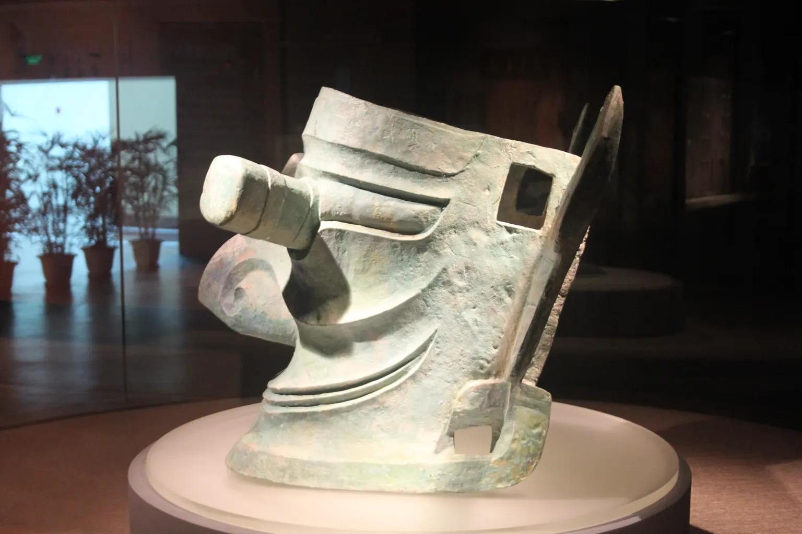

## 眼睛伸出了臉

這張臉最先抓住目光的，是伸到臉外的眼睛。圓柱狀的眼珠從眼眶向前突出，眉毛粗厚，鼻梁隆起，嘴角向兩側延伸。耳朵也被拉得很寬。它不是一張照著普通人五官比例做出的臉，卻有清楚安排過的線條：哪裡加寬、哪裡突出，觀看的人一眼就會注意到。

這是 Gary Todd 在三星堆博物館拍攝的縱目面具。看照片時，可以沿著眼睛的外緣移到臉頰，再找找額頭和臉側的孔。孔洞不是影像上的裝飾，而是器物外形的一部分。只是照片讓我們看見「有孔」，不能單靠孔就確定當年插了什麼、固定在哪裡。

上海大學博物館的展品解讀介紹一件一九八六年二號坑出土的青銅縱目面具，編號 K2②:148，寬一百三十八公分、高六十六公分。說明記錄了突出的瞳孔、向外展開的大耳和五個長方形孔洞，也提出孔洞可能用來固定其他物件。尺寸與孔洞是器物紀錄；怎樣安裝、為什麼這樣安裝，則需要另外解釋。

我們容易接著問：這張臉是誰？可是「誰做的」和「做的是誰」，並不是同一個問題。前者關係到工匠、材料與技術，後者關係到圖像代表的角色。即使能辨認鑄造接縫，也不等於已經讀出神像的名字；即使面具令人想到神話，也不能因此替製作者填上身分。

## 三星堆不是突然出現的一次發現

四川大學博物館的考古史資料，把早期工作帶回一九三四年。葛維漢與林名均等人在月亮灣進行發掘，記錄當地出土的玉器、石器與陶器。那時的工作規模與今天不同，但不是等到大面具出土，人們才第一次開始研究這片地方。

一九八六年，一、二號坑的發現讓青銅人像、面具與神樹進入更多人的視野。後來的研究並沒有只圍著這兩個坑打轉，聚落、城牆與遺址分布也都是考古問題。把三星堆縮成幾張面具照片，會看不見製作、使用與埋藏器物的人，原本生活在更大的環境裡。

二〇二四年《四川文物》刊出的三號坑與八號坑發掘簡報，讓讀者看見新一輪工作的細節。報告不只刊登漂亮的器物，還畫出坑的形狀、各層堆積與器物位置。考古學者要知道一件東西在哪一層、壓著什麼、旁邊有什麼，因為離開這些關係，器物就少了一部分能回答問題的線索。

三號坑簡報記錄已編號遺物二千六百八十六件。八號坑記錄七千三百九十七件（組），包含銅、金、玉、石、陶、骨、象牙與海貝等不同材料。這裡的「件（組）」不能全部改讀成一件件已經清理、修復完成的獨立文物。八號坑報告特別說明，有些中空銅器裡還有小器物，也有東西與銅鏽、象牙黏在一起，發掘時整體打包取出，等待室內清理；最終數量應以正式發掘報告為準。

這個括號很小，卻會改變讀法。統計數字描述的是整理到當時的狀態，不是永遠不變的總數。拆開一個包裹後，裡頭可能包含幾件原先無法分開登錄的東西；兩塊碎片修復後，也可能回到同一件器物上。考古報告保留限制，是讓後來的人知道數字怎麼來。

## 埋進土裡的時間，不是面具的生日

三號坑報告以坑中植物炭屑進行碳十四測年，再用校正曲線與統計模型換算日曆年代。學者推測的埋藏時間，在百分之九十五點四的機率範圍內，落在公元前一一一七至一〇一二年。八號坑則以填土與灰燼堆積中的八件炭化樣本進行分析，學者推測的相同機率範圍為公元前一一一七至一〇一五年。

這些是依樣本和模型推算的時間範圍，不是考古學者挖到一張寫著日期的紙。百分之九十五點四也不是「所有器物都有百分之九十五點四來自同一年」。兩份報告討論的是坑的形成或埋藏年代，樣本來自坑裡的炭化材料，並不是直接對青銅面具測出製造日期。

一件器物可以先被製作，經過使用、保存或修補，才進入土坑。三號坑報告也提醒，器物可能經過長期累積，製作年代與埋藏年代不能混為一談。因此，「大約在商代晚期埋下」不代表所有銅器、玉器都在那時一起製成，更不能把這個區間當成整個三星堆遺址的起訖年代。

年代範圍有重疊，可以支持進一步比較，卻不能單憑重疊就說兩個坑在同一天填好。要討論坑與坑的關係，還得看器物樣式、堆積方式，以及有沒有原本屬於同一件東西的部位。時間提供一條線索，碎片之間的連接則提供另一條。

## 隔著不同的坑，碎片又接上了

香港故宮文化博物館的三星堆展覽說明，介紹過一件從八號坑出土的大型青銅神獸。研究者利用三維掃描與模型，將它和三號坑的頂尊跪坐人像進行拼對；人像頂著的尊，其口沿又能連到一九八六年二號坑發現的部位。不同年份、不同坑出土的東西，在整理中重新產生關係。

這不是看見兩件器物很像，就任意把它們放在一起。拼對要檢查形狀與接口能否對上，數位模型則幫助研究者比較這些部位。博物館公布的拼對結果，是關於器物原有組合的線索；它沒有替我們重播完整的拆解與搬運過程。

三、八號坑簡報也討論跨坑可拼對的器物。學者據此推測，若原屬同一件器物的部位分在不同坑，加上堆積與器物特徵相近，相關坑的埋藏時間可能十分接近。不過，從「可以拼回去」走到「當時發生同一場儀式」，中間仍然有需要論證的步驟。究竟由誰拆開、間隔多久、搬運次序如何，不能只靠最後拼好的外形回答。

對研究者而言，碎片不只是破掉的成品。它們保留接口、厚薄與表面痕跡，可能讓原本分開的資料互相核對。新發掘也因此會改變舊藏品的讀法：一九八六年登錄的部位，到了新坑整理時，才找到能與它連在一起的其他部分。

## 先找製作痕跡，再談工匠是誰

二〇二三年刊於《四川文物》的鑄造工藝研究，從一、二號坑銅器的接縫、鉚接與加工痕跡，討論器物怎麼製成。研究比較的面具並非只有一種做法：有的耳部與面部一起鑄成，有的先分別鑄造，再接合起來。接合處留下的銅塊與溢出的金屬，成為判讀工序的依據。

孔洞也值得細看。有些可以在鑄造時預留，有些可能在鑄成後再加工。對觀眾而言，孔只是臉上的小方格；對研究者而言，孔緣與工具痕跡能幫忙區分先後步驟。這些線索讓「古人會不會做」變成更具體的問題：哪個部位先做，怎麼接合，最後又怎麼修整。

論文作者進一步推測，不同工藝可能反映多個工匠群體及技術傳統的參與。這是由製作差異提出的解釋，並不是已經找到一份工匠名冊。技術相似，也不自動代表同一個民族或同一位師傅；器物可以流動，做法也可能經由接觸與學習傳播。從接縫認出工序，比從接縫認出某個人的籍貫更有把握。

同一篇工藝研究也比較了尊、罍這些青銅容器與中原殷商器物的關聯。作者指出，三星堆的尊、罍多有商式風格，鑄造細節卻同時包含中原與南方的技術因素。至於器物究竟從中原輸入、來自長江中下游，還是在當地製作，學者意見不同。商式外形讓我們看見比較的方向，不能直接替每一件器物填上出產地。

玉器提供了另一種聯繫。三號坑出土的一件神樹紋玉琮，外形呈方柱，中間有圓孔，表面刻著神樹圖案。專文作者比較它的形制與磨損，推測原本的素面玉琮可能經過流傳與再加工，後來才加入神樹紋；它與甘肅、青海一帶齊家文化玉琮的相似，也讓作者討論外來器物的可能性。

「相似」不能直接改成「確定從那裡運來」。要判定一件器物的來歷，還需要更多材料、工藝與脈絡的對照。這件玉琮值得注意的地方，正是器形比較與當地神樹圖像能放在一起討論，而不是把三星堆想成完全沒有與外界往來的孤島。

四川省文物考古研究院在二〇二四年公布真武宮地點的工作，提到原料、半成品、廢料與成品等製作遺存。學者推測，這些組合是玉石器作坊留下的線索。這支持我們討論遺址內的生產活動，但玉石器作坊不等於青銅鑄造作坊，更不能據此指定照片中的縱目面具出自哪一間工坊。

## 奇特的臉，不是外星人的證據

有一種說法認為，三星堆器物造型太奇怪，可能和外星人有關。中國新聞網二〇二一年〈三星堆是外星人遺跡嗎？〉的報導，記錄了這類現代說法與考古工作者的回應。這是流行想像的出處，不是出土了一份記錄外星來客的材料。

一張臉的眼睛很大，能告訴我們作品把眼睛做得很突出；它本身不能證明製作者或圖像角色真的長成那樣。藝術可以改變比例。要理解這些改變的意義，仍須回到圖像組合、出土位置與同時代材料，而不是把不熟悉的外貌直接換成另一個星球的地址。

已有的工藝研究也讓問題更具體。我們能比較鑄造和接合的方法，能在玉器上辨認加工，能從遺址中的原料與廢料討論生產。這些線索通向人的工作。即使面具代表的角色仍有爭論，也不能把那個空白當成外星人的證據。

有一種說法認為，三星堆因為太神祕而停止挖掘。二〇二五年一月，中國互聯網聯合闢謠平台的查證報導引述發掘負責人冉宏林，說明三至八號坑的現場發掘階段已於二〇二三年結束，但室內清理、保護與研究仍在進行。這份有日期的說明，區分了「某一階段挖完」與「所有考古工作停止」；它也不是對此後每一年的工作進度作保證。

## 坑的名字，還不是用途的最後答案

報告常稱這裡為「祭祀區」，也討論「祭祀坑」。這些名稱包含研究者對用途的判斷。八號坑的分層顯示填埋有不同步驟，器物的擺放與保存狀態也不完全相同；報告作者據此討論有組織地埋藏祭祀用品的可能性，而不是單純把坑當成隨手丟棄東西的地方。

三號坑報告進一步區分「祭祀坑」與祭祀區裡的器物埋藏坑：目前沒有明確證據顯示，坑本身就是舉行祭祀活動的第一個場所。學者推測，它可能只是祭祀用品最後被集中埋下的地方。這個命名差別關係到我們是在找儀式現場，還是在看儀式之後的處理；發現與祭祀有關的器物，不等於已找到整場活動發生的地點。

學者推測，器物與古人的祭祀活動有關，但為什麼要埋下、哪些損壞出於人為、哪些來自碰撞或擠壓，仍需分別辨認。不能把每一件殘破器物都寫成經過同一種處理，更不能只憑坑名，就補出一場人物、動機與順序都確定的儀式。

從大眼睛出發，我們已經走到比外形更細的地方：孔、接縫、碎片、堆積與炭屑。這些東西未必像面具那麼醒目，卻讓提問有了可以查驗的對象。誰做了這些面具，現在能回答到的是材料、工序與可能的分工；要再往某一個人的名字走，還缺少能把人和器物直接連起來的紀錄。

## 還不知道的事

這些面具的製作者叫什麼名字，作品代表哪一位角色，本篇核對的報告仍無法回答。鑄造痕跡能辨認技術，卻不是署名；圖像與神話的相似也不是身分證。要把角色與古人的稱呼連起來，需要更直接的文字或能相互核對的出土脈絡。

跨坑拼對和測年縮小了討論範圍，仍沒有交代每一件器物如何從使用場所走到埋藏地點。埋藏的動機、組織者與完整過程，也缺少直接紀錄。八號坑尚待清理的組合更提醒我們，報告中的數量與復原並不是整理工作的終點。

下一個答案可能來自新找到的製作遺存，也可能來自庫房中兩塊終於接上的碎片。眼睛突出多少，可以測量；古人希望這雙眼睛看見什麼，還需要更多線索。
